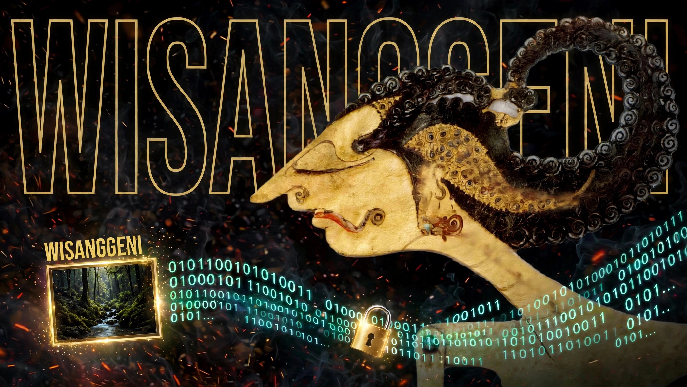

# Wisanggeni

Hide files and folders inside a PNG image.

Wisanggeni packs your input into a tar archive, compresses it with zstd,
encrypts it with XChaCha20-Poly1305 under a key derived from your passphrase,
and embeds the result into the pixels of a PNG you supply. Every channel of the
output changes by at most ±1, the dimensions never change, and the output has no
magic bytes and no plaintext length. With the wrong passphrase there is nothing
in the image to tell apart from noise.

It is a single Go binary with a command line and a terminal UI, no cgo, and no
runtime dependencies.

**This is not undetectable.** Confidentiality comes from the encryption, not
from the steganography. A modern ML steganalysis model trained on Wisanggeni
output, or an opponent who kept the original image, can tell the payload is
there. The design rule is simple: the steganography buys you not-obviousness,
nothing more. It has not had an independent security audit, so do not use it
where a mistake costs a life. Details in [Threat model](#threat-model).

## Contents

- [Install](#install)
- [Quick start](#quick-start)
- [The terminal UI](#the-terminal-ui)
- [Commands](#commands)
- [Choosing a carrier](#choosing-a-carrier)
- [Passphrase modes](#passphrase-modes)
- [Threat model](#threat-model)
- [Measured properties](#measured-properties)
- [Security testing](#security-testing)
- [Exit codes](#exit-codes)
- [How it works](#how-it-works)
- [Building and testing](#building-and-testing)

## Install

You do not need Go. Each release carries a static binary for Linux, macOS and
Windows, and the binary has no runtime dependencies: it runs on a bare system
with nothing installed.

Download an archive with `curl`, unpack it, and put the binary on your `PATH`.
The table below lists every archive; this example is for Linux on x86-64.

```sh
cd /tmp
curl -fsSLo wisanggeni.tar.gz \
  https://github.com/a-axa/wisanggeni/releases/download/v1.0.0/wisanggeni_1.0.0_linux_amd64.tar.gz
tar xzf wisanggeni.tar.gz wisanggeni
sudo install -m 0755 wisanggeni /usr/local/bin/wisanggeni
wisanggeni --help
```

On macOS and Linux, `install` writes into `/usr/local/bin`. If you do not have
`sudo`, or you would rather keep it in your home directory, use
`mkdir -p ~/.local/bin && mv wisanggeni ~/.local/bin/` instead and make sure
`~/.local/bin` is on your `PATH`.

### Which archive

| System | Archive |
|---|---|
| Linux, x86-64 | `wisanggeni_1.0.0_linux_amd64.tar.gz` |
| Linux, ARM64 | `wisanggeni_1.0.0_linux_arm64.tar.gz` |
| macOS, Intel | `wisanggeni_1.0.0_darwin_amd64.tar.gz` |
| macOS, Apple silicon | `wisanggeni_1.0.0_darwin_arm64.tar.gz` |
| Windows, x86-64 | `wisanggeni_1.0.0_windows_amd64.zip` |
| Windows, ARM64 | `wisanggeni_1.0.0_windows_arm64.zip` |

`uname -sm` prints the system and machine type, which map to the names above
(`x86_64` is `amd64`, `aarch64` is `arm64`). The macOS archives are not signed
or notarised, so Gatekeeper may refuse the first run; the Windows archives are
plain zips with `wisanggeni.exe` inside.

### Verify the download

Each release ships `checksums.txt` with a SHA-256 for every archive. Download
both files into the same directory, keep the archive's original name, and check
just your own row:

```sh
curl -fsSLo wisanggeni_1.0.0_linux_amd64.tar.gz \
  https://github.com/a-axa/wisanggeni/releases/download/v1.0.0/wisanggeni_1.0.0_linux_amd64.tar.gz
curl -fsSLo checksums.txt \
  https://github.com/a-axa/wisanggeni/releases/download/v1.0.0/checksums.txt
grep linux_amd64 checksums.txt > one.txt
sha256sum -c one.txt
```

The last line prints `wisanggeni_1.0.0_linux_amd64.tar.gz: OK`. On macOS use
`shasum -a 256 -c one.txt`; on Windows, `Get-FileHash` in PowerShell.

### With a Go toolchain

If you already have Go, one command installs the latest tagged release:

```sh
go install github.com/a-axa/wisanggeni@latest
```

Or build from a checkout:

```sh
make build      # writes bin/wisanggeni
```

## Quick start

```sh
# 1. Check that the carrier is noisy enough to be a good cover.
wisanggeni score photo.png

# 2. Hide a document. The output is a new PNG; photo.png is never modified.
wisanggeni hide notes.pdf -c photo.png -o secret.png

# 3. Prove the payload came back byte for byte.
wisanggeni reveal secret.png -o ./out

# 4. Look inside without extracting anything.
wisanggeni inspect secret.png
```

A folder works the same way:

```sh
wisanggeni hide ~/Documents/contracts -c photo.png -o secret.png
```

Run `wisanggeni` with no arguments to open the terminal UI.

## The terminal UI

The TUI covers the same operations as the CLI through the same engine, so a bug
only has to be fixed once and the two can never disagree about what a carrier
holds.

- **Hide** walks you through four screens: choose what to hide, choose the
  carrier, read the score and capacity, then type the passphrase twice. The
  carrier is scored and the payload measured before you are asked for a secret,
  so an impossible job fails early.
- **Reveal** asks for the image and the passphrase, then unpacks.
- **Score** and **Capacity** report on one image.
- **Inspect** names the payload. With no passphrase it stops at the encrypted
  header; with one it lists the archive contents without writing anything.

The picker takes `Enter` to open a folder or move on and `Space` to choose a
file. Below 80×24 the TUI asks you to use the CLI rather than rendering a broken
layout, and it is tested at that size.

## Commands

### `hide`

```
wisanggeni hide <input...> -c <carrier.png> -o <output.png> [flags]
```

| Flag | Meaning |
|---|---|
| `-c, --carrier` | Carrier PNG. Required. |
| `-o, --output` | Output PNG. Required, and must not be the carrier. |
| `--force` | Allow overwriting the output, a fill above 10%, and a smooth cover. |
| `--no-compress` | Skip zstd. |
| `--no-verify` | Skip the post-write verification. Not recommended. |
| `-q, --quiet` | Suppress the success line. |
| `--passphrase-file`, `--passphrase-stdin` | See [Passphrase modes](#passphrase-modes). |

The carrier is never touched. The output is written to a temporary file,
verified by decoding it again and comparing the embedded blob, and only then
renamed into place.

### `reveal`

```
wisanggeni reveal <image.png> -o <dir> [flags]
```

| Flag | Meaning |
|---|---|
| `-o, --output` | Destination directory, created if missing. Defaults to `.`. |
| `--force` | Allow replacing files that already exist. |
| `--max-output` | Ceiling on the decompressed size, in bytes. Default 1 GiB. |

The archive is treated as untrusted. Absolute paths, `..`, symlinks, hardlinks,
device nodes and FIFOs are refused, a pre-existing symlink in a parent directory
is not followed, and file modes are masked to `0o777` so setuid bits inside a
payload cannot survive.

### `capacity`, `score`, `inspect`

```sh
wisanggeni capacity photo.png   # four capacity figures and the cover verdict
wisanggeni score photo.png      # just the cover verdict
wisanggeni inspect secret.png   # header, and entries when a passphrase is given
```

`capacity` prints the numbers the other commands use:

```
file          photo.png
dimensions    256x256
channels      196608
capacity raw  12280 bytes
usable        12168 bytes
suggested     2345 bytes (10% fill)
strong        1116 bytes (5% fill)
cover         suitable (textured_fraction 1.000, median_rho 0.00278783)
alpha         no
chunks        none
```

## Choosing a carrier

The carrier decides almost everything about how detectable the result is.

Use a photo you took yourself. An opponent who has the original can diff the
pixels and prove something changed, no matter what the embedder does.

High resolution and heavy texture help: foliage, gravel, crowds, fabric. Avoid
screenshots, flat illustrations, and anything with large single-colour areas.
Run `wisanggeni score` first. It refuses a carrier whose textured fraction is
below 0.05, warns between 0.05 and 0.20, and accepts at 0.20 or above.

Keep the fill small. `hide` warns above 5%, refuses above 10% unless `--force`
is given, and refuses above 50% outright. `capacity` reports the suggested (10%)
and strong (5%) sizes for a given image.

Delete the original after hiding if you do not need it. Leaving it next to the
output invites a comparison.

Send the result as a file, not as a photo. WhatsApp, Instagram, X and Telegram's
photo mode all re-compress images, which destroys the payload. Telegram's file
mode and email attachments are fine.

Do not edit, resize, crop, or re-save the output. Any lossy step, and most
lossless ones, will destroy the payload.

## Passphrase modes

A passphrase never travels through a command-line argument or an environment
variable: arguments are visible in `ps` and shell history, and environment
variables leak into child processes.

| Mode | Use it when |
|---|---|
| Interactive prompt (default) | You are at a terminal. `hide` asks twice, so a typo cannot produce an unopenable file. |
| `--passphrase-file PATH` | A script needs a secret. Keep the file at mode `0600`; a looser mode produces a warning. |
| `--passphrase-stdin` | Piping from a password manager, e.g. `pass show site \| wisanggeni hide --passphrase-stdin`. Reads one line, no confirmation. |

Use a strong one. The key derivation is Argon2id with 64 MiB of memory and three
passes, which is slow enough to make guessing expensive but cannot rescue a weak
passphrase. Aim for at least five random words, for example from a diceware
list. The passphrase is normalised with NFKC first, so the same characters typed
on a different keyboard or input method derive the same key.

## Threat model

What protects your data, and what does not.

| Asset | Protection |
|---|---|
| **File contents** | XChaCha20-Poly1305 with a key from Argon2id, as long as the passphrase is strong. |
| **Existence of the data, fill ≤ 5%** | Adaptive cost map plus STC encoding into a naturally noisy cover. The blind attacks in [Measured properties](#measured-properties) see nothing; a detector trained on Wisanggeni itself was not measured. |
| **Existence of the data, fill 5-10%** | Allowed with a warning. The same two blind attacks still see nothing up to 40%, but assume this is the range where a targeted model starts to matter. |
| **Existence of the data, fill > 10%** | Requires `--force`. Assume a purpose-trained detector will find it. |

What is **not** protected:

- **Modern machine-learning steganalysis** (SRM plus an ensemble, or SRNet) at
  high fills, and in particular an opponent who trains a detector on Wisanggeni
  output specifically. The adaptive cost map leaves a statistical footprint that
  a targeted model can learn.
- **The original image.** An opponent who has it can compare pixels, which
  proves the image was modified and localises roughly where.
- **Recompression** by any platform or messenger that re-encodes the image.
- **A weak passphrase**, a keylogger, or coercion.
- **Implementation bugs.** There has been no independent security audit.

Confidentiality comes from the encryption; the steganography only adds a layer
of not-obviousness. Nothing here claims to be undetectable when the opponent
knows the algorithm and the fill is high.

## Measured properties

These numbers come from code that runs in CI, not from estimates.

| Property | Value | Where |
|---|---|---|
| Per-channel change | at most ±1 | `internal/stego/steganalysis_test.go` |
| PSNR at 10% fill | **62.7 dB** | same |
| PSNR at full capacity | **55.8 dB** | same |
| Pairs-of-values chi-square, clean cover | p = 0.0000 (clean) | `detector/steganalysis.py` |
| Same attack, LSB replacement | p = 1.0000 (flagged) | `detector/steganalysis.py` |

On a cover whose values are spread widely enough for the pairs-of-values attack
to have any power, the attack flags sequential LSB replacement outright and does
not flag a Wisanggeni carrier at any fill from 2% to 40%:

| Fill | chi-square p | RS (reg − sing) |
|---|---|---|
| clean cover | 0.0000 | 0.0238 |
| LSB replacement | 1.0000 (flagged) | 0.0006 |
| Wisanggeni 2% | 0.0000 | 0.0232 |
| Wisanggeni 5% | 0.0000 | 0.0218 |
| Wisanggeni 10% | 0.0000 | 0.0246 |
| Wisanggeni 20% | 0.0000 | 0.0191 |
| Wisanggeni 40% | 0.0000 | 0.0201 |

The chi-square result is a negative result, and it only means something because
the same code flags LSB replacement on the same cover. It has a limit worth
knowing: the attack needs a cover whose histogram pairs are sparsely populated.
On a structured or peaky cover the statistic sits below its own null
distribution even for the untouched image, so a high p-value there is evidence
of nothing. The samples use a high-entropy cover for that reason.

These two classic blind attacks are what the detector job checks. The PRD is
explicit that a detector trained on Wisanggeni output would do better, and that
figure is not measured here. Read the table as evidence that two standard
attacks see nothing, not as evidence that nothing can see the payload.

## Security testing

On 13 November 2026 the owner asked Muse, an AI agent, to try to recover
the contents of a real Wisanggeni output without the passphrase. The agent
built the tool from this repo, confirmed the payload was present from the
salt positions and the pattern of changed pixels, then tried 108 likely
passphrases plus 700 of an expanded 2148-entry dictionary, generic forensic
tools, the repo's own chi-square and RS detector, and a code audit. None of
it recovered the contents. With the passphrase supplied by the owner,
`reveal` then succeeded on the first try and returned one 11-byte text
file. Full report: [docs/test-report-2026-11-13.md](docs/test-report-2026-11-13.md).

This was a test, not an audit. It covers one sample, one carrier, and a
small payload, and it says nothing about a weak passphrase.

## Exit codes

| Code | Meaning |
|---|---|
| 0 | Success. |
| 1 | Usage or input error, including an existing output without `--force`. |
| 2 | The payload does not fit the carrier's capacity. |
| 3 | Wrong passphrase, no data, or corrupt data. Deliberately the same code and message for all three. |
| 4 | Post-write verification failed. |
| 5 | The carrier or the fill ratio is not suitable, and `--force` was not given. |

The three failures in code 3 share one error message on purpose. Distinguishing
them would tell an attacker whether they guessed the passphrase, found a stego
image, or found a broken one.

## How it works

```
input files → tar → zstd (if smaller) → XChaCha20-Poly1305 → STC embed → PNG
                 passphrase → Argon2id → HKDF ─┘                      │
                                                           verify ←──┘
```

1. **Pack.** Inputs become a deterministic tar, then zstd if that is smaller.
   The original file names are inside the encrypted archive.
2. **Derive.** The passphrase is normalised with NFKC, run through Argon2id
   (`t=3`, 64 MiB, `p=4`), and split with HKDF-SHA256 into an encryption key and
   a position seed.
3. **Encrypt.** The archive is sealed with XChaCha20-Poly1305. A 16-byte random
   salt and the nonces are the only plaintext structure; the header (version,
   flags, body length) is itself encrypted.
4. **Embed.** A cost map, computed from the original cover, estimates how
   expensive each channel is to change. The payload is written with syndrome
   trellis coding at one bit per channel, minimising total cost, so changes land
   in textured areas. A keyed permutation decides the channel order, so an
   opponent who knows the cost function still does not know which channels carry
   which bit.
5. **Verify.** The output file is decoded again and the blob compared, so a
   broken PNG writer or a bad embed aborts before the file is renamed into
   place.

`docs/FORMAT.md` is the frozen writer/reader contract: bit order, blob layout,
key derivation vectors, salt positions, capacities, cost map and the STC
parameters, each with the test vector that pins it. After the `v1.0.0` tag,
changing any of it means a new format version, because the blob has no plaintext
header a reader could use to detect the difference.

## Building and testing

```sh
make build      # bin/wisanggeni
make test       # go test -race ./...
make lint       # golangci-lint
make all        # lint, test, build
```

The end-to-end tests build the binary and drive it as a subprocess, so they
cover the real exit codes and `--passphrase-stdin`. The archive readers and the
container reader have fuzz targets:

```sh
go test ./internal/archive -run XXX -fuzz FuzzUnpack -fuzzminimizetime 3s
go test ./internal/stego   -run XXX -fuzz FuzzExtractSTC
go test ./internal/crypto  -run XXX -fuzz FuzzOpen
```

`detector/` holds the steganalysis tooling. It never ships inside the binary and
is stdlib-only:

```sh
python3 detector/steganalysis.py --make-samples /tmp/g3 --self-check \
    --binary ./bin/wisanggeni
python3 detector/stc_ref.py --check internal/stego/testdata/stc_vectors.json
```

## License

See [LICENSE](LICENSE).
